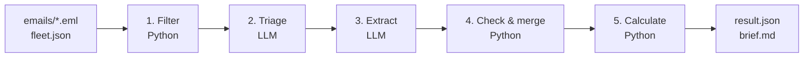

# Laytime & demurrage from a shipping inbox

A pipeline that reads a vessel's voyage emails and answers, for the active voyage:
**where is the vessel, how much laytime was used at each port, and how much demurrage is owed —
with the source email for every number.**

## Quick start

```bash
uv sync                      # install (requires uv)
cp .env.example .env         # then add your OPENROUTER_API_KEY
uv run laytime run           # read emails/, write output/KB-2603/
```

Writes `output/<voyage>/result.json` (every value with its source email and exact quote) and
`output/<voyage>/brief.md` (a one-page summary for an operator).

## Run the evaluation

```bash
uv run laytime eval                                                    # default models
TRIAGE_MODEL=<model> EXTRACT_MODEL=<model> uv run laytime eval         # any OpenRouter model with JSON schema support
```

Scores the output against the answer key in `eval/gold.json` and saves the scorecard with the run's
output in `eval/runs/<voyage>/experiment_<n>/`.

## How this pipeline works ?

This is **not an agentic pipeline**. It is a fixed sequence of Python steps with two focused LLM
calls in the middle. The LLM only reads and labels text; Python does everything that must be exact.



1. **Filter (Python).** Keep only emails that name one of our vessels on a voyage to remove noisy data. 
2. **Triage (LLM).** Classify each remaining email: what kind of document it is, and
   whether it matters for **laytime** (contract terms, port events, stoppages), only for the
   **schedule** (positions, ETAs), or **not at all**, with a one-line reason.
3. **Extract (LLM).** From the relevant emails, read the contract terms, or the port events and
   stoppages. Every fact comes back with the **exact quote** it was read from, as evidence.
4. **Check & merge (Python).** Convert all times to the port's time zone, verify every quote really
   appears in its email, let the addendum replace the recap and the final statement of facts replace
   the interim one, and record disagreements for a human to check.
5. **Calculate (Python).** Laytime per port and demurrage, following `DOMAIN.md` instructions.

### Why this design ?

- This is a first version, so I kept it simple and did not use an agentic approach.
- I did not use RAG: I could not see a reliable way to choose the top-K relevant emails, and missing
  one (such as the addendum that changes the demurrage rate) would silently give a wrong amount.
- Instead, a Python filter first keeps only the emails that name a vessel on a voyage (assuming every
  relevant email names its vessel), so each email that passes is already linked to its voyage.
- An LLM then classifies each email (does it matter for the schedule or for laytime, the two things
  the answer needs), a second LLM call extracts the facts, and Python does the checks and calculation.
- Most steps are plain Python functions that are easy to test, and each LLM step can be evaluated on
  its own.


## How I veryfied the answer ?

`eval/gold.json` was **drafted by Claude Opus 5.5 (high reasoning effort)** from the emails,
`TASK.md` and `DOMAIN.md`. I verified it by going through all 19 emails, and checked the most
important facts myself: the demurrage rate (including the addendum that changes it) and the ports. My knowledge of this domain is limited, so the answer key reflects my
understanding and **may contain mistakes**.

## Models, cost and comparison

**Default:** Gemini 3.5 Flash-Lite for triage and Gemini 3.8 Flash for extraction, both through
OpenRouter. Triage is a simple classification, so it uses the cheapest model; extraction is the hard
part (times, time zones, contract clauses, exact quotes), so it uses a stronger one. A full run makes
about 32 LLM calls and costs about **$0.10**. Costs are the real amounts OpenRouter reports, and every
run's cost, tokens and time are in `eval/runs/KB-2603/experiment_<n>/scorecard.json`.

To compare, I tried open models I am more familar, GPT-OSS and Gemma, and Mistral.

| # | Triage + extraction | Score | Demurrage | Cost per run | LLM time |
|---|---|---|---|---|---|
| 1 | Gemini 3.5 Flash-Lite + Gemini 3.8 Flash (default) | 129/130 | USD 65,343.75 | $0.102 | 125 s |
| 2 | Gemma 4 31B + Gemini 3.8 Flash | 129/130 | USD 65,343.75 | $0.098 | 150 s |
| 3 | Mistral Small 3.2 for both | 128/130 | USD 65,343.75 | $0.005 | 248 s |
| 4 | GPT-OSS 20B + GPT-OSS 120B | 104/117 | USD 0.00 | $0.006 | 279 s |


## Assumptions

- Every relevant email mentions the vesse name.
- Facts come only from what the sender wrote, not from older mail quoted below it.
- A time with no time zone label is local time at that port.
- A short date like `15/1630` is in the month and year the email was sent.
- laytime still running is counted up to the newest email, so the answer is provisional.
- A stoppage with no matching contract clause counts in full as laytime, and flag it.

## What doesn't work yet

- Emails that don't name the vessel, The  current filter needs the vessel's name, IMO number or call sign
  in the subject or text (a reply inherits it from its thread). A short message without will be missed.
- Facts are read only from what the sender wrote, not from older mail quoted
  below it. This avoids reading stale information as new, but a fact that only exists in a forwarded
  email is missed.
- There can be more complicated/contraduct working in the real emails, so there is possiblity that pipeline will not work well on those cases, since system prompt to llm has any bussiness rules yet.


## With another week

- More checks in code, based on the business rules. The calculation depends on times, so code should check that they make sense for example, laytime cannot end before it starts.
- A bigger, better evaluation set, Today there is one voyage of one vessel and 19 emails, and an answer key I could only partly verify. I can either find an open databse, or used an llm to generate one.
- Spend some more time in understanding the domain, there is possibility that I may miss something concepts in current versions
- Change the prompts and re-run the evaluation with each model, to see how much the results depend
  on the prompt wording and how much on the model.
- Edit some emails myself (other date formats, typos, a missing final statement of facts) and see how
  the output changes. Since I know the right answer for each edit, this also tests the answer key.

## How I used AI ?

- After reading the `TASK.md`, `DOMAIN.md` and the emails, I discussed this architecture with Claude Code that I had in mind.
- I used Claude Code (Claude Opus 5.5), Wrote a prompt about the design I want with some basic rules for testing, iterating in small steps(my validation after each step) and avoid adding unneccarry logic.